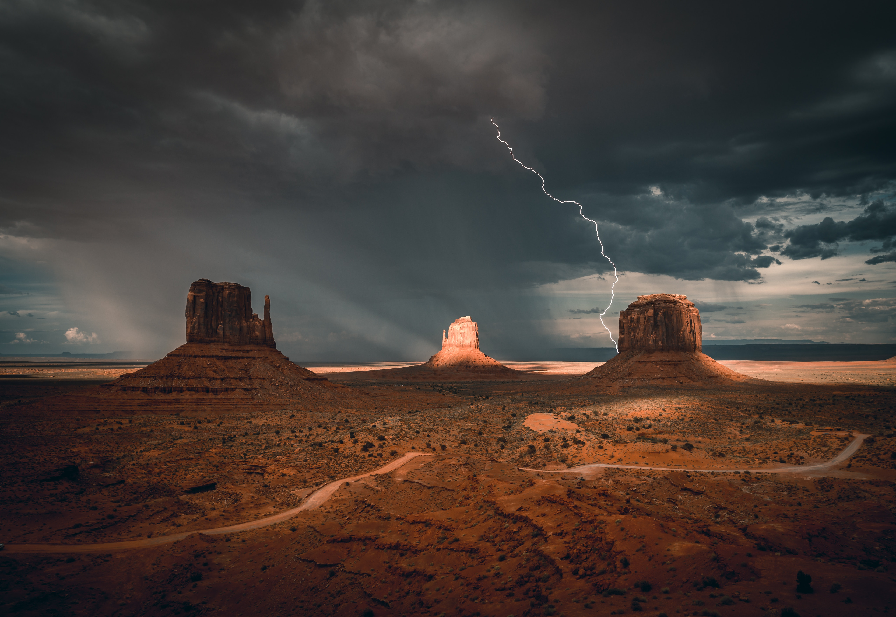

# Student Study Handout: Lesson 02
## Visual Storytelling, Spatial Agility & The Anatomy of a Dramatic Moment

**Student:** Hélène R.  
**Tutor:** Lewis O.  
**Session Focus:** Visual fluency, descriptive precision, accent neutralization, and incident diplomacy.

---

## 📸 The Visual Focus: Monument Valley Monsoon Lightning



> *"Nature doesn't ask for permission—it commands attention in a fraction of a second."*

---

## 1. The Anti-Freeze Toolkit: Spatial Anchors & Time-Buyers

When you are asked to describe an unfamiliar scene or diagram, never freeze or search for a single missing word. Use these **Spatial Anchors** to structure your thoughts:

```
+---------------------------+-------------------------------------------------------------+
| Spatial Anchor            | Example Natural Sentence                                    |
+---------------------------+-------------------------------------------------------------+
| In the foreground...      | "In the foreground, a winding dirt track cuts through the   |
|                           |  rugged red sandstone."                                     |
+---------------------------+-------------------------------------------------------------+
| Dominating the center...  | "Dominating the center of the frame are three colossal      |
|                           |  sandstone buttes."                                         |
+---------------------------+-------------------------------------------------------------+
| In the backdrop / distance| "In the backdrop, an ominous dark thunderhead looms over    |
|                           |  the desert horizon."                                       |
+---------------------------+-------------------------------------------------------------+
| Caught in the light...    | "Caught in an isolated shaft of sunlight, the middle butte  |
|                           |  glows bright orange."                                      |
+---------------------------+-------------------------------------------------------------+
| Stark contrast...         | "There is a stark contrast between the bright desert floor  |
|                           |  and the pitch-black rain clouds."                          |
+---------------------------+-------------------------------------------------------------+
```

---

## 2. Vocabulary & Expressions Vault

### 🏜️ Landscape & Atmospheric Precision
- **A sandstone butte** (`/ə ˈsænd.stəʊn bjuːt/`) — *Une butte témoin en grès* (steep, flat-topped desert rock).
- **A bolt of lightning** (`/ə bəʊlt əv ˈlaɪt.nɪŋ/`) — *Un coup de foudre / un éclair*.
- **A thunderhead / Cumulonimbus** (`/ˈθʌn.də.hed/`) — *Un nuage d'orage imposant*.
- **Shafts of sunlight / Sunbeams** (`/ʃɑːfts əv ˈsʌn.laɪt/`) — *Des rais de lumière / rayons de soleil*.
- **Arid & desolate** (`/ˈær.ɪd/ • /ˈdes.ə.lət/`) — *Aride et désertique / isolé*.
- **A winding dirt track** (`/ə ˈwaɪn.dɪŋ dɜːt træk/`) — *Une piste en terre battue qui serpente*.
- **Virga / Rain curtain** (`/ˈvɜː.ɡə/`) — *Des rideaux de pluie visibles sous l'orage*.

### ⚡ Idioms & Metaphors
- **A bolt from the blue** — Something completely unexpected that happens suddenly (*Un coup de tonnerre dans un ciel serein*).
  - *Example:* *"The server crash was a complete bolt from the blue; everything was running smoothly five minutes earlier."*
- **The calm before the storm** — A quiet period before a burst of intense activity or chaos (*Le calme avant la tempête*).
  - *Example:* *"Enjoy this quiet Friday morning—once the new ERP update rolls out, it won't be calm!"*
- **To weather the storm** — To survive or navigate through a difficult period successfully (*Surmonter la tempête / faire le dos rond*).
  - *Example:* *"Our team weathered the storm during the major database migration last quarter."*
- **In the blink of an eye** — In an instant (*En un clin d'œil*).
  - *Example:* *"The lightning struck in the blink of an eye, but the photographer was ready."*

---

## 3. Pronunciation & Sound Clinic

### 🎯 1. The Aspirated /h/ vs. Silent /h/
In French, the letter *h* is silent. In English, breathe warm air onto your palm:
- **Breathe out (/h/):** **H**orizon (`/hɒˈraɪ.zən/`), **H**arsh (`/hɑːʃ/`), **H**eavy (`/ˈhev.i/`), **H**uge (`/hjuːdʒ/`).
- **Clean vowel entry (no /h/):** Arid (`/ˈær.ɪd/`), Isolated (`/ˈaɪ.sə.leɪ.tɪd/`), Ominous (`/ˈɒm.ɪ.nəs/`).

### 🎯 2. Word Stress: Punch the Drum
Clap your hands on the **CAPITALIZED** syllable:
- **MON**-u-ment (`/ˈmɒn.jə.mənt/`) — 3 syllables.
- ho-**RI**-zon (`/hɒˈraɪ.zən/`) — Middle stress.
- e-**LEC**-tri-fy-ing (`/ɪˈlek.trɪ.faɪ.ɪŋ/`) — Punch the *LEC*.
- **PHE**-nom-e-non (`/fəˈnɒm.ɪ.nən/`) — Punch the *NOM*.

### 🎯 3. Past-Tense `-ed` Rules
- **Extra syllable (/ɪd/):** Only after /t/ or /d/ ➔ *illuminate ➔ illuminated*, *anticipate ➔ anticipated*.
- **No extra syllable (/d/ or /t/):** *capture ➔ captured (/d/)*, *strike ➔ struck (irregular)*, *flash ➔ flashed (/t/)*.

---

## 4. Workplace Challenge: The "Incident Flashpoint" Standup

### Scenario:
Imagine an unexpected system crash or API timeout hit your automotive spare parts catalog overnight. In your daily international standup, report the incident using your new vocabulary:

```
"Good morning everyone. Overnight, we experienced an unexpected issue with our 
parts synchronization script—it really was a bolt from the blue. 

Under the hood, a database timeout occurred right around 02:00 AM, which caused 
inventory discrepancies in the warehouse module. 

We've already isolated the root cause and deployed a hotfix. The system has 
completely weathered the storm, and we expect full data reconciliation by 11:00 AM."
```
